<b>Me gusta darle movimiento a las ideas y hacer que las máquinas entiendan su entorno.</b>

## Hola, soy Nicolás 🤖

Soy ingeniero mecatrónico de la Universidad EAN, en Bogotá, Colombia. Me apasionan la **robótica y la inteligencia artificial**, especialmente cuando se encuentran con la visión por computador, la electrónica y el mundo físico.

Construyo soluciones de principio a fin: entiendo el problema, diseño la herramienta e integro lo necesario para llevarla a la práctica. También desarrollo software en Python, automatizo procesos y convierto datos en información útil.

**Me interesa explorar:** robots que perciben y actúan · visión por computador · IA aplicada · sistemas autónomos.

## Proyectos para explorar

| Proyecto | Qué encontrarás |
| :--- | :--- |
| 👁️ **[Visión artificial](https://github.com/Nicolas211202/vision-artificial)** | Reconocimiento facial con panel web, gestión de usuarios, historial y reportes. |
| 📊 **[Excel Universal Analyzer](https://github.com/Nicolas211202/Excel-Universal-Analyzer)** | Análisis de Excel, gráficas e informes PDF para usuarios sin conocimientos técnicos. |
| 🔌 **[API de Rick and Morty](https://github.com/Nicolas211202/API)** | Cliente de consola en Python para buscar personajes por ID o combinar filtros, con modo interactivo. |
| 🎮 **[Microconsola ATTINY85](https://github.com/Nicolas211202/ATTINY85)** | Electrónica y programación en C++ alrededor de un microcontrolador ATTINY85. |

<b>🦾 Abre mi laboratorio de robótica y mecatrónica</b>

- **Verde Inteligente:** proyecto de grado que integra IA en Python con una banda transportadora para clasificar residuos en tiempo real. Participé en el desarrollo del modelo, el diseño mecánico y la integración electrónica.
- **Brazo robótico de 6 grados de libertad:** diseño en SolidWorks, construcción y programación en C/C++ para aplicaciones de manufactura.
- **EanBot:** vehículo autónomo que toma decisiones a partir de sensores. Primer puesto en un concurso universitario de robótica móvil en 2022.
- **Vehículo eléctrico de competencia:** diseño e integración de sistemas mecánicos, frenos hidráulicos y frenado regenerativo con motores BLDC.

## Mi caja de herramientas

| Área | Herramientas y conocimientos |
| :--- | :--- |
| **Robótica y electrónica** | Arduino · ESP32 · PLC · ROS · sensores y actuadores |
| **IA y visión por computador** | OpenCV · MediaPipe · reconocimiento facial · detección en tiempo real |
| **Software y datos** | Python · FastAPI · pandas · SQL · C/C++ · MATLAB |
| **Automatización y análisis** | n8n · Power Automate · integración de APIs · Power BI · Excel |
| **Diseño y fabricación** | SolidWorks · Fusion 360 · FEA · impresión 3D · corte láser · escáner 3D |

<b>⚙️ Ingeniería aplicada a problemas reales</b>

En **Profamilia** desarrollé de forma independiente un sistema de reconocimiento facial para varias clínicas, con FastAPI, MediaPipe y SQLite, llevado a un piloto operativo. También construí un pipeline de análisis financiero en Python para generar indicadores y reportes.

En **COROU, Australia**, desarrollé un sistema de registro de horas por captura fotográfica y automaticé el cálculo de pagos quincenales junto con el área contable.

Me interesa conectar el desarrollo técnico con la necesidad de quienes van a utilizar la solución.

<b>🌎 Un poco más sobre mí</b>

- Español nativo e inglés B2, preparando C1.
- Experiencia en producción técnica de eventos: sonido, iluminación y video en vivo.
- Fui subrepresentante estudiantil de la Facultad de Ingeniería de la Universidad EAN.
- Me entusiasma conversar sobre robótica, IA aplicada y proyectos que combinan hardware y software.

